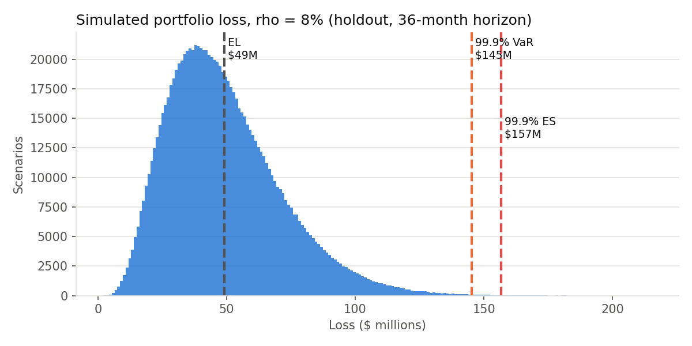
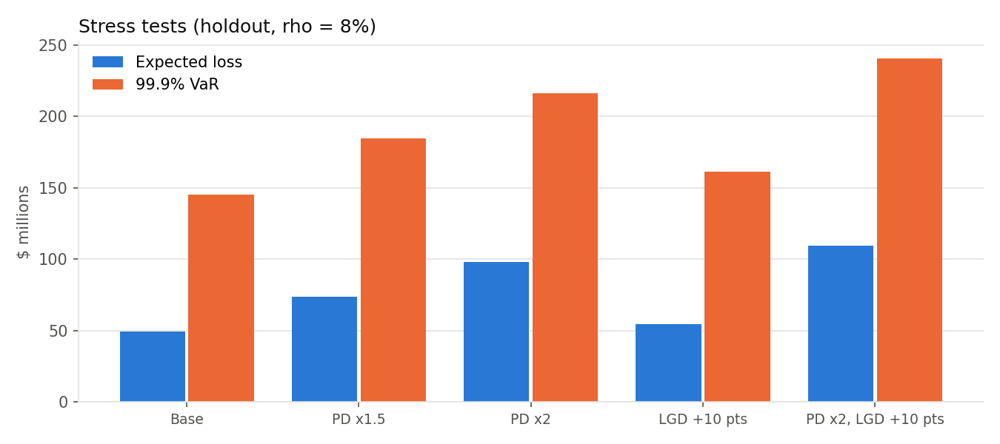
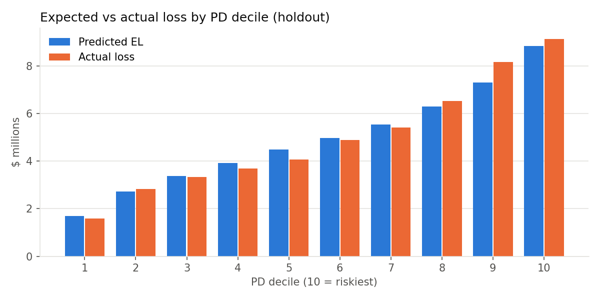
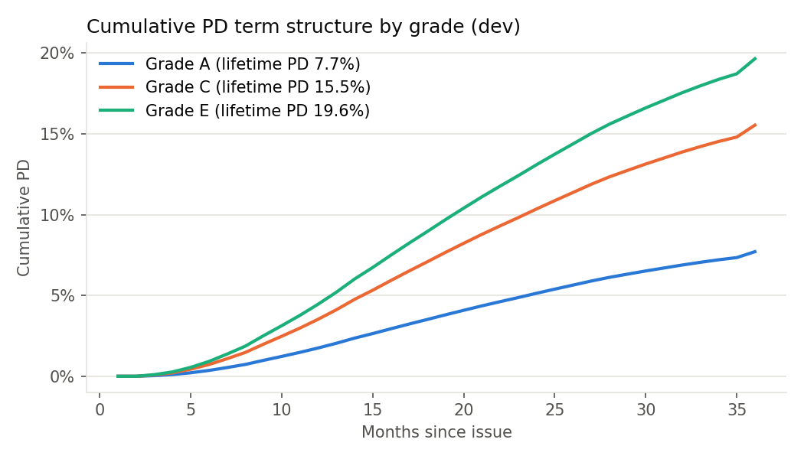

# Lending Club Credit Risk: from PD to Capital

An end-to-end retail credit-risk workflow on 306,000 Lending Club consumer loans (36-month, issued 2012 to 2014). It builds a probability-of-default model and turns it into the numbers a bank risk team uses: **PD, EAD, LGD, Expected Loss, credit VaR and Expected Shortfall, Basel IRB capital, stress tests, model validation and IFRS 9 staging**.

## Headline results (holdout: 60,958 loans, $765M funded)

| Measure | Result |
| --- | --- |
| PD model (logistic regression) | AUC 0.650, Gini 0.30, KS 0.22 on holdout; PSI 0.015 between 2012 and 2014 loans (stable) |
| Expected Loss vs actual loss | **$49.2M predicted vs $49.6M actual** (6.42% vs 6.48% of funded) |
| Exposure at Default | 57% of the amount funded (51% for grade A, 70% for grade G) |
| Loss Given Default | 88.8% on average; 16% of defaults recover nothing |
| 99.9% credit VaR / ES (ρ = 8%, loan-life horizon) | $145M / $157M; economic capital $96M (12.5% of funded) |
| Basel IRB "other retail" capital | $40.4M (RWA $505M); my one-factor simulation gives $40.8M |
| Severe stress (PD ×2, LGD +10 pts) | EL rises from $49M to $109M; 99.9% VaR from $145M to $240M |
| IFRS 9, 12 months after issue | ECL $36.3M = 7.5% of balances; Stage 2 loans default 3× as often as Stage 1 |

| | |
| --- | --- |
|  |  |
|  |  |

Method, choices, limits and Q&A: **[EXPLAINER.md](EXPLAINER.md)**.

## Files

| Path | What it is |
| --- | --- |
| `credit_risk_analysis.ipynb` | Main notebook: 13 steps, one small step per cell, runs top to bottom in about 30 seconds |
| `data_prep.py` | Loads the Kaggle file, cleans it and splits it into dev / test / holdout |
| `risk_helpers.py` | Functions: PD and LGD models, default timing, Vasicek loss simulation, IRB formula, PSI |
| `results/` | Result tables (aggregates only) |
| `figures/` | Charts |
| `data/` | Put the Kaggle file here (never uploaded) |

## How to run

1. Download `accepted_2007_to_2018Q4.csv` from [Kaggle: All Lending Club loan data](https://www.kaggle.com/datasets/wordsforthewise/lending-club) into `data/`.
2. Create the environment once:
   ```bash
   python3 -m venv .venv
   .venv/bin/pip install -r requirements.txt
   ```
3. Open the notebook and choose **Run → Run All Cells**:
   ```bash
   .venv/bin/jupyter lab credit_risk_analysis.ipynb
   ```

Models are fitted on dev (60%), choices are made on test (20%), and the holdout (20%) is scored once at the end.
